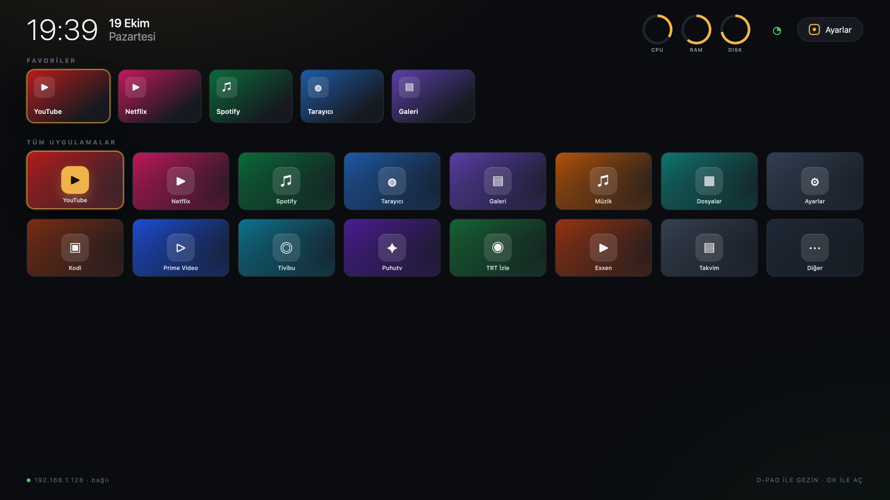

# Sade Launcher

> A minimal, animation-free, D-pad-first Android TV / Google TV launcher built for low-RAM boxes.

[](https://developer.android.com/training/tv)
[](https://openjdk.org/)
[](#performance)
[](LICENSE)

<p align="center">
  <a href="https://www.buymeacoffee.com/cmtrkr"></a>
</p>

Sade Launcher replaces the stock Android TV home screen with a quiet grid of apps: a clock, two lines of date, your favourites, and everything installed. No carousel, no recommendations, no animations, no background services. It was tuned for a 2 GB Skyworth Google TV box (armeabi-v7a, Android 14 / API 34) and measured at roughly **149 KB APK**, **39 MB PSS** and **0.5 s cold start**.

## 📸 Screenshot

<p align="center">
  
  <br>
  <sub>Representative preview built from the launcher's real layout, colors and typography — not a TV capture.</sub>
</p>

## ✨ Features

- 🕒 **Clock and date** — large time, `19 Ekim` and `Pazartesi` beneath it, refreshed every 20 seconds.
- 🧱 **Dynamic app grid** — columns, rows and tile size adapt to the number of installed apps:

  | Apps | Grid | Behaviour |
  | --- | --- | --- |
  | ≤ 12 | 4 × 3 | Largest tiles (up to 200×124 dp) |
  | 13–20 | 5 × 4 | No scrolling |
  | 21–30 | 6 × 5 | No scrolling |
  | 31+ | 5 × 4 | Scrolling rows |

- 🎨 **Icon-derived gradients** — each tile's 45° gradient is built from the app icon's dominant color, mixed with a dark base.
- ⭐ **Favourites strip** — long-press a tile to add or remove it; favourites scale exactly like grid tiles.
- 🔀 **Move and reorder** — long-press → **Taşı / sırala**, use the D-pad, **OK** to save, **BACK** to cancel. Order persists; new apps append at the end. A reset-to-alphabetical action is included.
- 🧭 **Long-press menu** — favourite, move, open, app info and uninstall (hidden for system apps).
- 📶 **Network status** — Ethernet or Wi-Fi icon, green when the internet is reachable, red when not.
- 📊 **System monitor** — three rings for RAM %, average CPU frequency and `/data` usage, refreshed every 2 seconds only while the home screen is visible.
- ⚙️ **Settings button** — focusable pill in the header; long-press requests the default-launcher role.
- 🚫 **No accidental exit** — BACK does nothing on the home screen.
- 🪶 **Tiny footprint** — no support libraries except RecyclerView; window animations disabled.

## 🏗️ Project structure

```text
app/src/main/java/com/sade/tvlauncher/
├── MainActivity.java       # Screen, focus, favourites, long-press menu
├── AppRepository.java      # Installed apps, icon downscaling, dominant color
├── AppGridAdapter.java     # Shared adapter for grid and favourites
├── TileBackgrounds.java    # 45° gradients from icon colors
└── AppEntry.java
```

## 🚀 Build

Requirements: JDK 17, Android SDK 34, Gradle 8.9+ (or Android Studio).

```bash
# From the project root
./gradlew assembleDebug
# APK: app/build/outputs/apk/debug/app-debug.apk

./gradlew assembleRelease
# APK: app/build/outputs/apk/release/app-release.apk
```

Install on a connected TV/box:

```bash
adb install -r app/build/outputs/apk/release/app-release.apk
```

If you open the project in Android Studio, point `local.properties` → `sdk.dir` at your own SDK.

## 📺 Making it the default launcher

On Google TV, the HOME button is locked to the stock LauncherX. Granting the HOME role is not always enough: Android 12+ resets the priority of user-installed launchers, and the stock launcher can reclaim HOME unless the setup guardian is disabled. A working sequence on a rooted/unlocked box is:

```bash
adb shell cmd role add-role-holder --user 0 android.app.role.HOME com.sade.tvlauncher
adb shell cmd package set-home-activity com.sade.tvlauncher/com.sade.tvlauncher.MainActivity
adb shell pm disable-user --user 0 com.google.android.tungsten.setupwraith
adb shell am force-stop com.google.android.apps.tv.launcherx
adb shell pm uninstall --user 0 com.google.android.apps.tv.launcherx
```

> These commands change system behavior. Read them before running, and keep a way to restore the stock launcher. `pm uninstall --user 0` removes the app for the current user only; the system APK remains on disk.

## ⚠️ Notes

- The UI follows the device language (Turkish and English strings are included).
- The launcher needs the `QUERY_ALL_PACKAGES`-style visibility queries declared in the manifest to list Leanback and normal launcher apps.
- Tested on a low-RAM Google TV box; behavior on phones is not a target.
- System-monitor CPU values are average frequency from `cpufreq` counters, because `/proc/stat` is restricted on the target device.

## ❤️ Support

If Sade Launcher makes your TV calmer, you can buy me a coffee:

<p align="center">
  <a href="https://www.buymeacoffee.com/cmtrkr"></a>
</p>

## 📄 License

[MIT](LICENSE) © 2026 Cem Türker.

Sade Launcher is an independent project and is not affiliated with Google or Skyworth.
